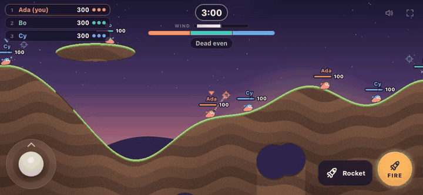
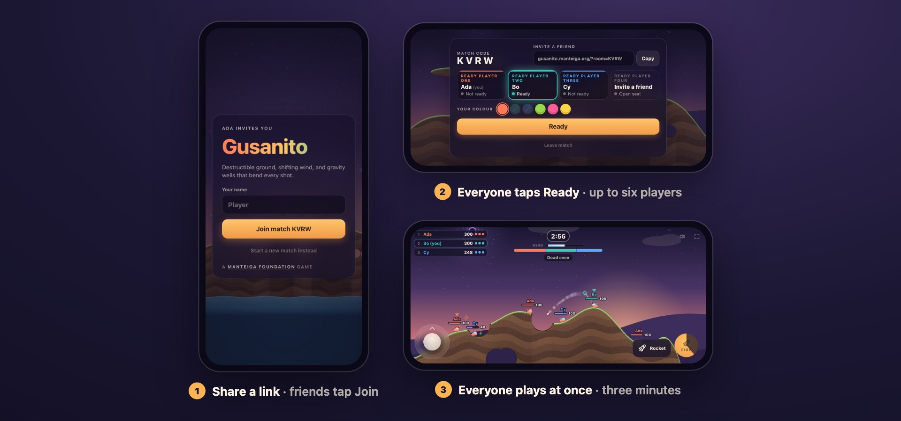

# Gusanito

Gusanito is a free online artillery game for two to six players, in the spirit of Worms. Play it
in the browser at [gusanito.manteiga.org](https://gusanito.manteiga.org), on a phone or a computer,
with nothing to install.

Each player brings three worms to the same map of destructible ground, and everyone plays at once,
so a match lasts three minutes at most. Wind and gravity wells bend the shots and shift every
fifteen seconds. One player shares a link, and friends join from theirs.

<p align="center">
  <a href="https://gusanito.manteiga.org"></a>
</p>

<p align="center">
  <a href="https://gusanito.manteiga.org"></a>
  <a href="https://github.com/manteiga-foundation/gusanito/releases/latest"></a>
  <a href="https://github.com/manteiga-foundation/gusanito/actions/workflows/ci.yml"></a>
  
  <a href="LICENSE"></a>
</p>

<p align="center">
  <a href="#play">Play</a> · <a href="#install">Install your own server</a> · <a href="#how-a-match-works">How a match works</a> · <a href="#controls">Controls</a> · <a href="#development">Development</a>
</p>

## Play

Open [gusanito.manteiga.org](https://gusanito.manteiga.org) on a phone or a computer, type a name
and tap **Create match**. Share the link the lobby shows. The match starts when everyone has tapped
**Ready**. There is nothing to install and no account to make.

<p align="center">
  
</p>

## Install

To run your own Gusanito server, on your own network or to change the game:

```sh
curl -fsSL https://gusanito.manteiga.org/install.sh | sh
```

```sh
gusanito          # starts the server and prints the addresses to open
gusanito update   # installs the latest release
```

`gusanito` prints two addresses: one for the computer it runs on, and one that phones on the same
Wi-Fi can open.

<table>
  <tr><td><b>Installs</b></td><td>Bun, if it is missing; the latest release in <code>~/.gusanito/app</code>; the <code>gusanito</code> command in <code>~/.local/bin</code></td></tr>
  <tr><td><b>Updates</b></td><td><code>gusanito update</code>. A failed update leaves the installed copy working.</td></tr>
  <tr><td><b>Removes</b></td><td><code>rm -rf ~/.gusanito ~/.local/bin/gusanito</code></td></tr>
</table>

> [!NOTE]
> The installer supports macOS and Linux. On Windows, play in the browser, or run the game from a
> clone as described under [Development](#development).

<details>
<summary>Read the script first, or choose a version</summary>

```sh
curl -fsSL https://gusanito.manteiga.org/install.sh -o install.sh
less install.sh
sh install.sh

# a specific release, or the latest code on main
curl -fsSL https://gusanito.manteiga.org/install.sh | GUSANITO_VERSION=v1.0.0 sh
curl -fsSL https://gusanito.manteiga.org/install.sh | GUSANITO_VERSION=main sh
```

</details>

## How a match works

- **Lobby.** Each player has a card, from Ready Player One to Ready Player Six, and picks a colour
  no one else has. The match starts when at least two players are in and all of them are ready.
  Anyone who joins during a match plays in the next one.
- **Everyone at once.** After a three-second countdown, all players move, aim and fire at the same
  time. Each weapon reloads before it fires again.
- **Your worm stays yours.** Fire as often as you like with the same worm, and tap another of your
  worms to switch. When your worm dies, control passes to the next one.
- **Wind and wells.** The wind pushes rockets. Gravity wells pull on every projectile in flight
  and swallow any that reach their core. Every fifteen seconds the wind changes and the wells drift
  to new places.
- **The clock.** A match lasts three minutes, and the water rises during the last one. The last
  team standing wins; when time runs out, the team with the most health left wins. Everyone then
  returns to the lobby for a rematch, and each player's wins are kept.
- **Standings.** A board ranks the teams and crowns the leader. The bar under the clock shows each
  team's share of the health left.
- **Dropped connections.** A lost connection pauses the match, and reopening the page returns the
  player to the same seat. After 90 seconds away, that player's worms are out and the match goes on.

## Controls

| Action | Phone | Keyboard |
| --- | --- | --- |
| Walk and jump | Joystick: push sideways to walk, up to jump | Left and Right, or A and D; Enter or J to jump |
| Aim | Drag on the field; the worm aims at your finger | Up and Down, or W and S |
| Power and fire | Hold **Fire** to build power, release to shoot; a full charge fires by itself | Hold Space, release to shoot |
| Switch worm | Tap another of your worms | Tab |
| Weapon | The weapon button opens the tray | 1 to 4 |
| Look around | Drag with two fingers; pinch to zoom | Mouse wheel to zoom |

### Weapons

| Weapon | How it behaves | Reload |
| --- | --- | --- |
| Rocket | Explodes on impact; the wind pushes it | 1.6 s |
| Grenade | Bounces, then explodes after three seconds | 1.6 s |
| Cluster | Splits into five bomblets; two per match | 2.4 s |
| Shotgun | Hits instantly along the line of aim | 0.9 s |

A direct hit from a rocket or a grenade takes about half of a worm's health.

## Development

Gusanito is TypeScript on [Bun](https://bun.sh) 1.2 or later, with no framework. The server runs
the game and streams 30 updates a second over WebSockets; the browser draws them on a canvas. Every
image and sound is made in code.

```sh
git clone https://github.com/manteiga-foundation/gusanito
cd gusanito
bun install
bun run build
bun run start      # http://localhost:8080
```

```sh
bun run check      # TypeScript
bun run test       # game engine, rooms, server, installer, README
bun run test:e2e   # emulated phones in Chromium: lobby, play, reconnection, layout
```

The browser tests need Playwright's Chromium: `bunx playwright install chromium`.

<details>
<summary>More scripts</summary>

```sh
bun run og-card              # renders the link preview image, public/og-card.jpg
bun docs/readme/make.ts      # records the README GIF and images from real matches (needs ffmpeg)
bun run test:live            # the browser tests against the live site
bun run deploy               # deploys to Fly.io
```

</details>

<details>
<summary>Where things are</summary>

- `src/shared/`: the game itself (terrain, worms, projectiles, wind, wells, the match clock) and the
  messages between server and browser. The same seed and inputs always give the same match.
- `src/server/`: rooms, the lobby, and the HTTP and WebSocket server. The server decides what
  happens; browsers send inputs and draw what comes back.
- `src/client/`: drawing, controls, sound and reconnection.
- `public/`: the page, styles, icon, link preview image, robots.txt and sitemap.
- `install.sh`: the one-command installer.

</details>

### Deploying a public server

The live game runs on [Fly.io](https://fly.io) (`fly.toml`, `Dockerfile`). Rooms live in memory,
so the app runs on exactly one machine: `bun run deploy` passes `--ha=false` to keep it that way.
The machine stops when idle and starts on the next visit.

## Contributing

Issues and pull requests are welcome. Run `bun run check` and `bun run test` before opening a pull
request. To report a security problem, see [SECURITY.md](SECURITY.md).

## Licence

[MIT](LICENSE), © 2026 Manteiga Foundation.

## Credits

A [Manteiga Foundation](https://manteiga.org) game. Gusanito is inspired by the Worms series by
Team17 and is not affiliated with it.
