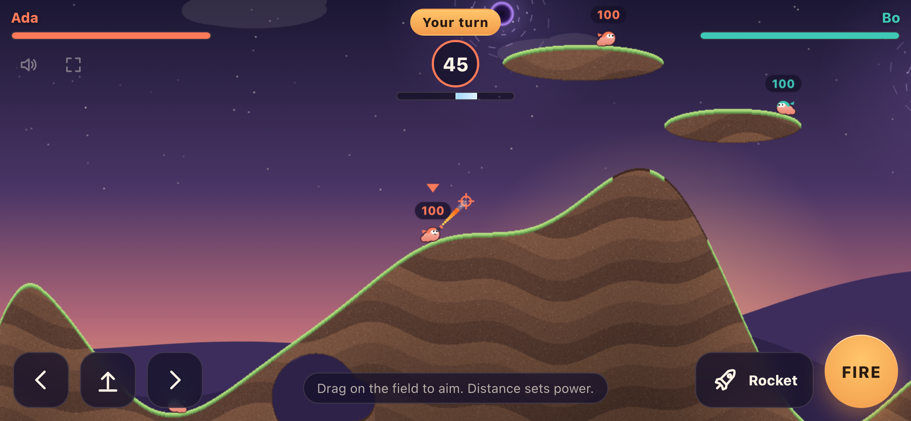

# Gusanito

Online artillery for 2 to 6 players in the spirit of Worms: destructible 2D ground, wind that changes every
turn, and gravity wells that bend every projectile. Plays in the browser on phones and desktops.

Live: https://gusanito.manteiga.org (also https://wriggle-game.fly.dev)

A Manteiga Foundation game.




## How a match works

1. One player taps **Create match**. The lobby shows the invite link with **Copy** and **Share**;
   the link previews as a card naming who is inviting and the code.
2. Friends open the link (the main button reads **Join match CODE**) or enter the code.
3. The lobby shows a card per player, **Ready Player One** to **Ready Player Six**. Each player picks
   a team colour no one else has. The match starts when at least two are in and everyone is ready.
   Someone who joins while a round is on waits for the next one.
4. Every player brings three worms to the same map. After a 3-second countdown everyone plays at
   once. Your worm stays under your control after firing; tap another of your worms to switch (it
   also switches by itself when yours dies). Each weapon reloads before it can fire again.
5. A match lasts 3 minutes and the water rises during the last minute. The last team standing wins;
   at the final whistle the healthiest team wins. Everyone returns to the lobby for a rematch, with
   each player's wins kept.

During play the top-left board ranks the teams (health, worms standing, a crown on the leader), and
a shared bar under the clock shows each team's share of the health left, with a caption such as
"You lead by 170".

A dropped connection pauses the match; reopening the page rejoins the same seat. A player gone for
90 seconds forfeits their worms and the others play on.

## Controls

| Action | Phone | Keyboard |
| --- | --- | --- |
| Walk and jump | Joystick: push sideways to walk, push up to jump | Left / Right or A / D; Enter or J jumps |
| Aim | Drag on the field: the worm aims at your finger | Up / Down or W / S |
| Power and fire | Hold Fire to build speed, release to shoot (full charge fires by itself) | Hold Space, release |
| Switch worm | Tap another of your worms | Tab |
| Weapon | Weapon button opens the tray | 1 to 4 |
| Look around | Two-finger drag and pinch | Mouse wheel zooms |

Weapons and reloads (a direct rocket or grenade takes about half a worm): Rocket (wind-affected, explodes on impact, 1.6 s), Grenade (bounces, 3 s fuse,
1.6 s), Cluster (splits into five bomblets, two per match, 2.4 s), Shotgun (instant hitscan, 0.9 s).

## Requirements

- Bun 1.2 or later
- For browser tests: Playwright 1.64 Chromium (`bunx playwright install chromium` if missing)
- For deployment: flyctl, logged in

## Run locally

```sh
bun install
bun run build
bun run start          # http://localhost:8080
```

To play from a phone on the same Wi-Fi, open `http://<your-computer-ip>:8080`.

## Verify

```sh
bun run check          # TypeScript
bun run test           # engine, rooms, WebSocket server, random-play fuzz
bun run test:e2e       # two emulated phones: create, join, ready, aim, fire, reconnect
bun run test:live      # the same browser flow against the deployed instance
```

## Link preview image

`bun run og-card` renders `public/og-card.jpg` (1200x630) from a real match scene.

## Deploy

```sh
bun run deploy         # fly deploy --ha=false
```

Rooms live in memory, so the app must run on exactly one machine; `--ha=false` keeps it that way.
The machine stops when idle and starts on the next request.

## Layout

- `src/shared/` game simulation (terrain mask, worms, projectiles, wind, wells, match clock, two concurrent players) and the
  wire protocol; deterministic for a given seed and input sequence.
- `src/server/` room and lobby logic (`rooms.ts`, transport-independent) and the Bun HTTP and
  WebSocket server. The server is authoritative and streams 30 snapshots per second.
- `src/client/` canvas renderer with crater repainting, input, audio synthesis, reconnection.
- `public/` page shell, styles, manifest, icon.

## Licence

MIT. All art and sound are generated in code.
