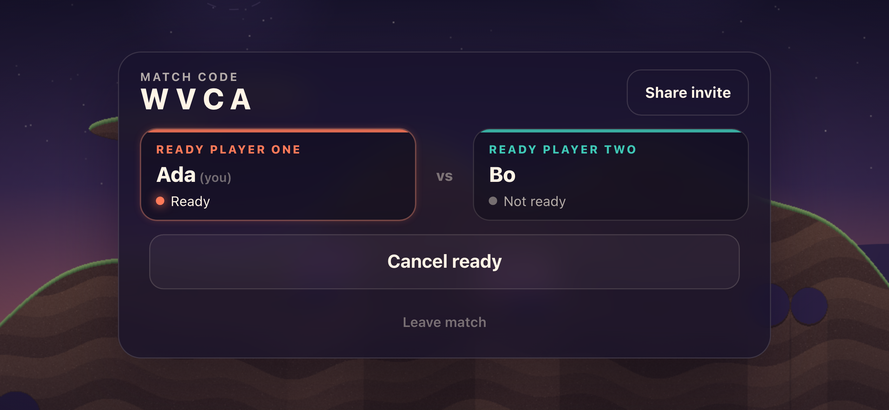

# Wriggle

Two-player online artillery in the spirit of Worms: destructible 2D ground, wind that changes every
turn, and gravity wells that bend every projectile. Plays in the browser on phones and desktops.

Live: https://wriggle-game.fly.dev (custom domain gusanito.manteiga.org pending certificate validation)

A Manteiga Foundation game.




## How a match works

1. One player taps **Create match**. The lobby shows the invite link with **Copy** and **Share**
   (the phone's share sheet). The link previews as a card naming who is inviting and the code.
2. The other player opens the link or enters the code and taps **Join**.
3. The lobby shows **Ready Player One** and **Ready Player Two**. Each player picks a team colour
   (six options; the two players never share one). The match starts when both are ready.
4. After a 3-second countdown both players play at the same time. Each controls one of their three
   worms; firing hands control straight to their next worm while the weapon reloads (the Fire
   button refills). Wind shifts every 15 seconds and the gravity wells drift.
5. A match lasts 3 minutes and the water rises during the last minute. The last team with a worm
   standing wins; at the final whistle the team with more health wins. Both players return to the
   lobby for a rematch; the score carries over.

During play the top of the screen shows who is winning: each team's remaining health and worms
standing, a crown on the leader, and a caption such as "You lead by 170". Two treatments exist,
`?hud=bar` (one shared tug-of-war bar) and `?hud=cards` (scoreboard cards); the choice is remembered.

A dropped connection pauses the match; reopening the page rejoins the same seat. A player gone for
90 seconds forfeits.

## Controls

| Action | Phone | Keyboard |
| --- | --- | --- |
| Walk | Hold the arrow pads | Left / Right or A / D |
| Jump | Jump pad | Enter or J |
| Aim and power | Drag on the field: direction aims, distance from the worm sets power | Up / Down or W / S aims; hold Space to charge, release to fire |
| Fire | Fire button | Space |
| Weapon | Weapon button opens the tray | 1 to 4 |
| Look around | Two-finger drag and pinch | Mouse wheel zooms |

Weapons and reloads: Rocket (wind-affected, explodes on impact, 1.6 s), Grenade (bounces, 3 s fuse,
1.6 s), Cluster (splits into five bomblets, two per match, 2.4 s), Shotgun (instant hitscan, 0.9 s).

## Requirements

- Bun 1.2 or later
- For browser tests: Playwright 1.64 Chromium (`bunx playwright install chromium` if missing)
- For deployment: flyctl, logged in

## Run locally

```sh
bun install
bun run build
bun run start          # http://localhost:8080
```

To play from a phone on the same Wi-Fi, open `http://<your-computer-ip>:8080`.

## Verify

```sh
bun run check          # TypeScript
bun run test           # engine, rooms, WebSocket server, random-play fuzz
bun run test:e2e       # two emulated phones: create, join, ready, aim, fire, reconnect
bun run test:live      # the same browser flow against the deployed instance
```

## Link preview image

`bun run og-card` renders `public/og-card.jpg` (1200x630) from a real match scene.

## Deploy

```sh
bun run deploy         # fly deploy --ha=false
```

Rooms live in memory, so the app must run on exactly one machine; `--ha=false` keeps it that way.
The machine stops when idle and starts on the next request.

## Layout

- `src/shared/` game simulation (terrain mask, worms, projectiles, wind, wells, turn flow) and the
  wire protocol; deterministic for a given seed and input sequence.
- `src/server/` room and lobby logic (`rooms.ts`, transport-independent) and the Bun HTTP and
  WebSocket server. The server is authoritative and streams 30 snapshots per second.
- `src/client/` canvas renderer with crater repainting, input, audio synthesis, reconnection.
- `public/` page shell, styles, manifest, icon.

## Licence

MIT. All art and sound are generated in code.
